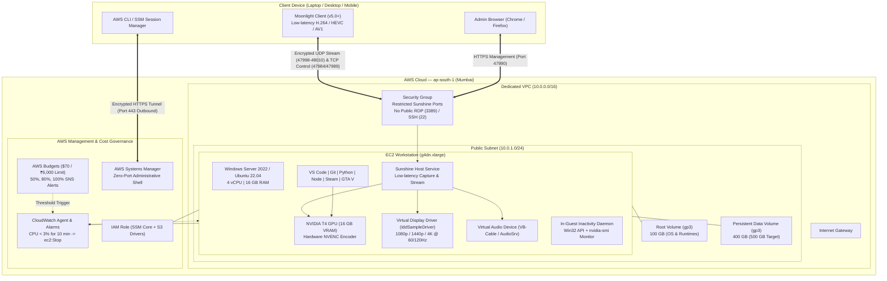
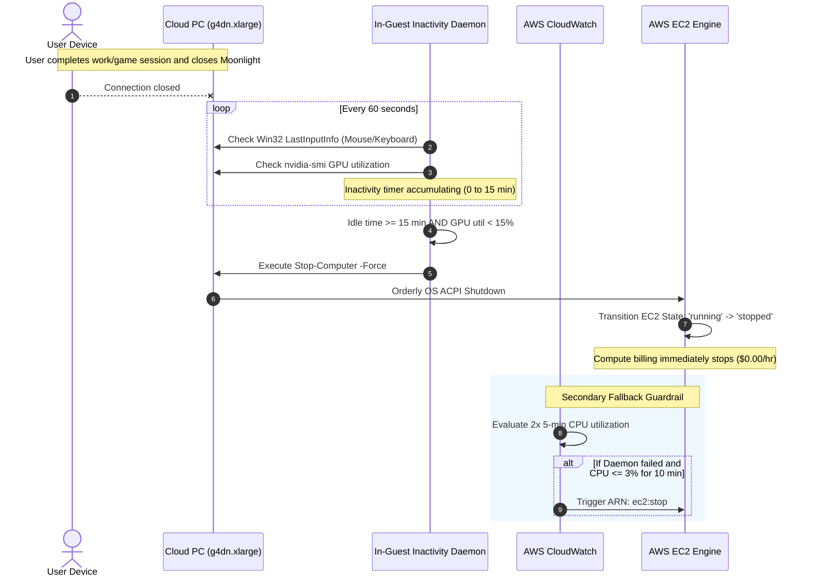

# Codevern Cloud PC — Technical Architecture & System Design

## 1. Architectural Overview

**Codevern Cloud PC** is an enterprise-grade, GPU-accelerated cloud workstation designed for high-fidelity interactive remote desktop streaming, intensive software development, and 3D gaming (e.g., GTA V). The infrastructure is deployed on Amazon Web Services (AWS) in the **Asia Pacific - Mumbai (`ap-south-1`)** region, optimized for sub-30ms latency across the Indian subcontinent.

The system addresses the fundamental limitation of low-specification client hardware by offloading all graphics rendering, CPU execution, and data persistence to a cloud-hosted virtual machine equipped with an **NVIDIA T4 Tensor Core GPU**.

---

## 2. End-to-End System Architecture

---

## 3. Layered Component Breakdown

### 3.1 Network & Perimeter Layer
* **VPC:** Custom VPC (`10.0.0.0/16`) in `ap-south-1` isolated from default AWS networking.
* **Subnet:** Single availability zone public subnet (`10.0.1.0/24`) attached to an Internet Gateway (`IGW`).
* **Zero-Open-RDP Security Group:**
  * In strict compliance with **PRD Section 9**, RDP (port 3389) and SSH (port 22) are blocked from the public internet.
  * System administration is executed out-of-band via **AWS Systems Manager (SSM) Session Manager**, which establishes an encrypted agent channel without requiring public inbound ports.
  * **Sunshine Ingress Rules:**
    * TCP 47984, 47989 (Discovery & Moonlight session control)
    * TCP 47990 (Sunshine Web Admin GUI over TLS)
    * TCP 48010 (RTSP control)
    * UDP 47998–48002, 48010 (Real-time video, audio, control, and ping frames)

### 3.2 Compute & Graphics Acceleration Layer
* **Instance Type:** `g4dn.xlarge`
  * **Compute:** 4 vCPUs (Intel Cascade Lake custom processors)
  * **Memory:** 16 GiB System RAM
  * **GPU:** 1x NVIDIA T4 Tensor Core (16 GiB GDDR6 VRAM)
  * **Hardware Video Codecs:** Dedicated NVENC engine supporting HEVC (H.265), H.264, and AV1 video encoding at ultra-low latency (`ull`).
* **Display Emulation (IddSampleDriver):**
  * Headless EC2 servers do not have an attached physical monitor, which normally prevents Windows Desktop Duplication API (DXGI) and NVENC from capturing video frames.
  * The architecture incorporates an Indirect Display Driver (`IddSampleDriver`) that registers a virtual display supporting **1080p, 1440p, and 4K at 60Hz and 120Hz**, allowing full hardware rasterization and streaming.

### 3.3 Storage Management & Persistence Layer
* **Storage Target:** 500 GB total persistent storage.
* **Separation of Concerns:**
  * **Root Volume (`/dev/sda1` or `xvda`):** 100 GB `gp3` holding Windows Server 2022, system drivers, developer runtimes, and caching. Flagged with `delete_on_termination = false`.
  * **Secondary Data Volume (`xvdf` / `D:`):** 400 GB `gp3` independent persistent volume dedicated to user workspaces, Git repositories, Steam library, and gaming installations.
* **Volume Performance:** Baseline `gp3` performance delivers **3,000 IOPS** and **125 MB/s throughput** without provisioning surcharges.
* **Persistence Guarantee:** Volumes remain intact when the EC2 instance transitions to the `stopped` state. Data is never lost upon machine shutdown.

### 3.4 In-Guest Audio & Gamepad Subsystem
* **Audio:** Windows Audio Service (`Audiosrv`) is activated and coupled with a virtual audio loopback device (VB-Cable). Sunshine captures stereo/surround audio with low latency and transmits it to the client.
* **Input & Controllers:** ViGEmBus (Virtual Gamepad Emulation Bus) translates client-side gamepads (Xbox One, Series X/S, DualShock 4, DualSense) into local virtual XInput controllers, enabling seamless controller gameplay in GTA V and Steam titles.

---

## 4. Remote Streaming Protocol Comparison

To satisfy **PRD Section 5.6 and Phase 1 research requirements**, the table below evaluates candidate streaming technologies:

| Evaluation Metric | Sunshine + Moonlight (Selected) | NICE DCV (AWS Native) | Parsec | Windows RDP |
| :--- | :--- | :--- | :--- | :--- |
| **Primary Focus** | Ultra-low-latency Gaming & Interactive Desktop | Engineering Workstations & CAD | Low-latency Gaming | Remote Server Administration |
| **Video Encoding** | Hardware NVENC (H.264 / HEVC / AV1) | Hardware NVENC / CPU Fallback | Proprietary NVENC Pipeline | Software RDP Codec |
| **Interactive Latency** | **8 – 18 ms** (Best-in-class) | 25 – 45 ms | 12 – 22 ms | 70 – 150+ ms |
| **Gaming & 3D Performance** | **Exceptional (60–120 FPS)** | Good (30–60 FPS) | Exceptional (60 FPS) | Poor (Unplayable for 3D) |
| **Licensing & Cost** | **100% Free & Open Source** | Free on AWS EC2 instances | Free tier / Paid Teams | Included with Windows Server |
| **Client Device Support** | Windows, macOS, Linux, Android, iOS, ChromeOS | Web Browser, Windows, Linux, Mac | Windows, macOS, Android | Windows, macOS, iOS, Android |
| **Gamepad Pass-Through** | Native XInput/DirectInput via ViGEmBus | Basic | Native | Very limited |
| **Deployment Complexity** | Moderate (Requires virtual display driver) | Low (AWS AMI available) | Moderate (Requires login account) | Minimal |

**Architectural Decision:** Sunshine + Moonlight is selected as the primary protocol because it delivers the highest frame rates, lowest input lag, full controller compatibility for GTA V, and zero software licensing overhead. NICE DCV is maintained as an optional secondary protocol for browser-based administrative fallback.

---

## 5. Cost Guardrail & Automated Shutdown Architecture

---

## 6. Multi-User Scalability Roadmap (PRD Section 15)

While the initial deliverable is a single-user MVP operating strictly within the ₹6,000 monthly budget, the underlying modular architecture enables expansion into a multi-tenant platform:

1. **Centralized Authentication Broker:**
   - Integrate AWS Cognito or Auth0 for user identity and role-based access.
2. **Session Orchestrator & Web Dashboard:**
   - Serverless API Gateway + AWS Lambda microservices to trigger EC2 instance starts on demand.
3. **Storage Disaggregation:**
   - Mount user profiles from Amazon FSx for Windows File Server or Amazon EFS, allowing compute instances to be treated as stateless, ephemeral workers.
4. **Fleet Auto-Scaling:**
   - Warm pools of Spot instances to eliminate boot delays while maintaining 60%+ cost savings.
